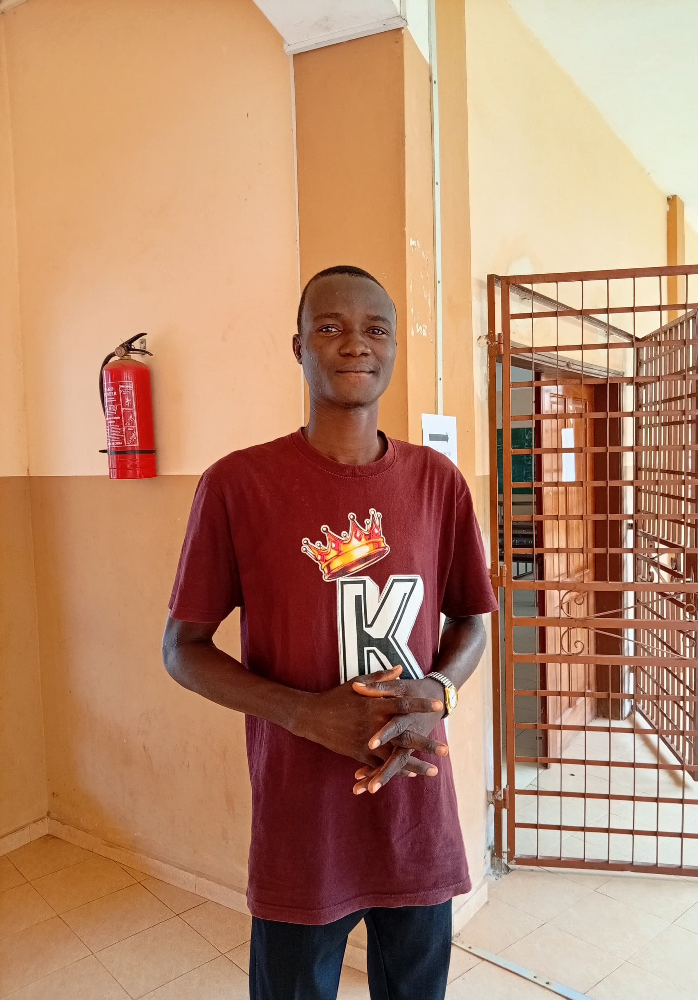

<!-- _class: cover -->
<!-- _paginate: false -->

  
  
  

GPU CHALLENGE 2026

# VIGIE-TRUST

  Évaluation du risque de crédit des petits commerçants 
  <strong>par données alternatives et IA explicable</strong>

  Données simulées · Capacité de remboursement sans historique bancaire

ÉQUIPE ERA NOVA

---

## L'exclusion financière en chiffres

<svg width="44" height="44" viewBox="0 0 44 44" fill="none" style="display:block;margin:0 auto 10px;"><circle cx="22" cy="22" r="20" stroke="#F4A261" stroke-width="1.8"/><path d="M22 6 C12 6 4 13 4 22 C4 31 12 38 22 38" stroke="#F4A261" stroke-width="2" stroke-linecap="round"/><path d="M22 6 C32 6 40 13 40 22 C40 31 32 38 22 38" stroke="rgba(244,162,97,0.25)" stroke-width="2" stroke-linecap="round"/><line x1="4" y1="22" x2="40" y2="22" stroke="#F4A261" stroke-width="1.2" stroke-dasharray="3 2"/><line x1="22" y1="6" x2="22" y2="38" stroke="#F4A261" stroke-width="1.2" stroke-dasharray="3 2"/></svg>

350M

adultes non bancarisés en Afrique subsaharienne

World Bank, 2025

<svg width="44" height="44" viewBox="0 0 44 44" fill="none" style="display:block;margin:0 auto 10px;"><rect x="6" y="6" width="32" height="32" rx="5" stroke="#2E86AB" stroke-width="1.8"/><path d="M13 30 L18 22 L23 26 L30 14" stroke="#2E86AB" stroke-width="2.2" stroke-linecap="round" stroke-linejoin="round"/><circle cx="30" cy="14" r="2.5" fill="#2E86AB"/></svg>

25%

taux de bancarisation stricte UEMOA 2024

BCEAO / Sika Finance

<svg width="44" height="44" viewBox="0 0 44 44" fill="none" style="display:block;margin:0 auto 10px;"><circle cx="22" cy="22" r="20" stroke="rgba(200,80,80,0.35)" stroke-width="1.8"/><path d="M22 6 A16 16 0 0 1 38 22" stroke="#E07070" stroke-width="3" stroke-linecap="round"/><path d="M22 6 A16 16 0 1 0 38 22" stroke="rgba(200,80,80,0.18)" stroke-width="3" stroke-linecap="round"/><line x1="15" y1="15" x2="29" y2="29" stroke="#E07070" stroke-width="2.2" stroke-linecap="round"/><line x1="29" y1="15" x2="15" y2="29" stroke="#E07070" stroke-width="2.2" stroke-linecap="round"/></svg>

~70%

petits commerçants refusés faute d'historique bancaire

IFC, 2024

<h3 class="teal" style="font-size:0.80rem;">Paradoxe mobile money</h3>

Paiements marchands &gt; <strong>100 Mrd USD</strong> en 2024 en Afrique — mais ces flux n'ouvrent aucun accès au crédit formel.

<h3 class="gold" style="font-size:0.80rem;">Contexte Bénin · PNIF 2026</h3>

SNIF 2023-2027 vise <strong>85 %</strong> d'inclusion. PNIF lancé le <strong>24 nov. 2026</strong> — microcrédits en 48h pour 14 IMF partenaires.

---

## La problématique

<svg width="38" height="38" viewBox="0 0 38 38" fill="none" style="flex-shrink:0;margin-top:2px;"><circle cx="19" cy="19" r="17" stroke="#F4A261" stroke-width="1.6"/><circle cx="19" cy="13" r="4.5" stroke="#F4A261" stroke-width="1.8"/><path d="M9 32 C9 25 29 25 29 32" stroke="#F4A261" stroke-width="1.8" stroke-linecap="round"/><line x1="32" y1="5" x2="36" y2="1" stroke="#E07070" stroke-width="2" stroke-linecap="round"/><line x1="36" y1="5" x2="32" y2="1" stroke="#E07070" stroke-width="2" stroke-linecap="round"/></svg>

<h3 class="gold">Le commerçant invisible</h3>

Vendeuses de marché, artisans, micro-entrepreneurs — des flux économiques <strong>réels mais invisibles</strong>. Pas de compte bancaire, pas de collatéral reconnu.

<svg width="38" height="38" viewBox="0 0 38 38" fill="none" style="flex-shrink:0;margin-top:2px;"><rect x="4" y="8" width="30" height="22" rx="4" stroke="#2E86AB" stroke-width="1.6"/><line x1="4" y1="16" x2="34" y2="16" stroke="#2E86AB" stroke-width="1.5"/><path d="M16 26 L19 23 L22 25 L26 20" stroke="#E07070" stroke-width="1.8" stroke-linecap="round" stroke-linejoin="round"/></svg>

<h3 class="teal">L'impasse des modèles classiques</h3>

Historique bancaire de <strong>12–24 mois</strong> requis minimum. Résultat : refus systématique, recours aux usuriers, cycle de pauvreté.

<svg width="50" height="50" viewBox="0 0 50 50" fill="none" style="margin-bottom:12px;"><circle cx="25" cy="25" r="23" stroke="#F4A261" stroke-width="1.6"/><path d="M18 18 C18 13 32 11 32 20 C32 25 25 26 25 30" stroke="#F4A261" stroke-width="2.4" stroke-linecap="round"/><circle cx="25" cy="36" r="2" fill="#F4A261"/></svg>

Comment évaluer la solvabilité de quelqu'un qui n'existe pas dans le système ?

Les données sont là — mobile money, tontines, flux de ventes — mais non exploitées.

---

## Notre solution · Le profilage augmenté

Gouvernance augmentée — VIGIE-TRUST outille l'expert, il ne le remplace pas.

<svg width="34" height="34" viewBox="0 0 34 34" fill="none" style="margin-bottom:10px;"><rect x="7" y="3" width="14" height="26" rx="4" stroke="#2E86AB" stroke-width="1.8"/><circle cx="14" cy="25" r="1.8" stroke="#2E86AB" stroke-width="1.5"/><line x1="9" y1="9" x2="19" y2="9" stroke="#2E86AB" stroke-width="1.5"/><path d="M23 11 L29 17 L23 23" stroke="#F4A261" stroke-width="2" stroke-linecap="round" stroke-linejoin="round"/></svg>
<h3 class="teal">Collecte alternative</h3>

Transactions mobile money · régularité tontine · flux dépôts/retraits · intégration marché

35+ variables

<svg width="34" height="34" viewBox="0 0 34 34" fill="none" style="margin-bottom:10px;"><circle cx="17" cy="17" r="15" stroke="#F4A261" stroke-width="1.8"/><path d="M9 23 C9 14 25 14 25 23" stroke="#F4A261" stroke-width="2" stroke-linecap="round"/><circle cx="17" cy="12" r="3.5" stroke="#F4A261" stroke-width="2"/></svg>
<h3 class="gold">Profilage IA + Règles</h3>

XGBoost GPU <strong>× 55%</strong> + 10 règles métiers contextuelles <strong>× 45%</strong>

Score hybride dynamique

<svg width="34" height="34" viewBox="0 0 34 34" fill="none" style="margin-bottom:10px;"><rect x="4" y="10" width="8" height="14" rx="2" stroke="#5ECBA1" stroke-width="1.8"/><rect x="14" y="6" width="8" height="18" rx="2" stroke="#5ECBA1" stroke-width="1.8"/><rect x="24" y="14" width="6" height="10" rx="2" stroke="rgba(94,203,161,0.5)" stroke-width="1.8"/><line x1="4" y1="28" x2="30" y2="28" stroke="#5ECBA1" stroke-width="1.5"/></svg>
<h3 class="green">Décision expliquée SHAP</h3>

Facteurs favorables et pénalisants visibles — l'agent comprend <strong>pourquoi</strong> et peut challenger.

Transparent

VIGIE-TRUST donne au chargé de crédit une <strong>vision augmentée</strong> — la décision reste humaine.

---

## Les trois piliers

01

<svg width="36" height="36" viewBox="0 0 36 36" fill="none" style="margin-bottom:10px;"><rect x="3" y="3" width="30" height="30" rx="5" stroke="#2E86AB" stroke-width="1.8"/><path d="M9 26 L14 18 L18 22 L22 14 L27 9" stroke="#2E86AB" stroke-width="2.2" stroke-linecap="round" stroke-linejoin="round"/><circle cx="27" cy="9" r="2.5" fill="#2E86AB"/></svg>
<h3 class="teal">Prédiction par modèle</h3>

XGBoost GPU Tesla T4 · <strong>700 000</strong> profils · 35+ variables alternatives

AUC 0.87 7.1× GPU

02

<svg width="36" height="36" viewBox="0 0 36 36" fill="none" style="margin-bottom:10px;"><circle cx="18" cy="18" r="15" stroke="#F4A261" stroke-width="1.8"/><path d="M10 24 C10 16 26 16 26 24" stroke="#F4A261" stroke-width="2" stroke-linecap="round"/><line x1="18" y1="7" x2="18" y2="13" stroke="#F4A261" stroke-width="2" stroke-linecap="round"/><line x1="10" y1="10" x2="14" y2="14" stroke="rgba(244,162,97,0.4)" stroke-width="1.5" stroke-linecap="round"/><line x1="26" y1="10" x2="22" y2="14" stroke="rgba(244,162,97,0.4)" stroke-width="1.5" stroke-linecap="round"/></svg>
<h3 class="gold">Convolution règles métiers</h3>

<strong>10 règles</strong> africaines — ratio survie, tontine, cohérence flux/revenu, charge remboursement

Dynamique Score 0–100

03

<svg width="36" height="36" viewBox="0 0 36 36" fill="none" style="margin-bottom:10px;"><circle cx="18" cy="18" r="15" stroke="#5ECBA1" stroke-width="1.8"/><path d="M11 18 L16 23 L25 12" stroke="#5ECBA1" stroke-width="2.5" stroke-linecap="round" stroke-linejoin="round"/></svg>
<h3 class="green">Explicabilité SHAP</h3>

Chaque décision décomposée — le chargé de crédit <strong>voit pourquoi</strong>, peut challenger et décider.

Transparent Challengeable

---

<!-- _class: light -->

## Résultats du modèle

<svg width="30" height="30" viewBox="0 0 30 30" fill="none" style="display:block;margin:0 auto 6px;"><path d="M3 22 L9 14 L14 18 L20 9 L27 5" stroke="#168A62" stroke-width="2.2" stroke-linecap="round" stroke-linejoin="round"/><circle cx="27" cy="5" r="2.5" fill="#168A62"/></svg>

0.87

AUC-ROC · XGBoost GPU

<svg width="30" height="30" viewBox="0 0 30 30" fill="none" style="display:block;margin:0 auto 6px;"><path d="M15 3 L18 11 L27 11 L20 17 L23 25 L15 20 L7 25 L10 17 L3 11 L12 11 Z" stroke="#2E86AB" stroke-width="1.8" fill="none" stroke-linejoin="round"/></svg>

7.1×

accélération GPU vs CPU

<svg width="30" height="30" viewBox="0 0 30 30" fill="none" style="display:block;margin:0 auto 6px;"><rect x="3" y="7" width="24" height="16" rx="4" stroke="#F4A261" stroke-width="1.8"/><line x1="3" y1="13" x2="27" y2="13" stroke="#F4A261" stroke-width="1.5"/><line x1="11" y1="7" x2="11" y2="23" stroke="#F4A261" stroke-width="1" stroke-dasharray="2 2"/></svg>

700K

profils · 35+ variables

<svg width="30" height="30" viewBox="0 0 30 30" fill="none" style="display:block;margin:0 auto 6px;"><circle cx="15" cy="15" r="12" stroke="#1A3A5C" stroke-width="2"/><path d="M15 3 A12 12 0 0 1 27 15" stroke="#1A3A5C" stroke-width="3" stroke-linecap="round"/><path d="M15 3 A12 12 0 1 0 27 15" stroke="#E4E7EC" stroke-width="3" stroke-linecap="round"/></svg>

80%

précision classification

<table>
<thead><tr><th>Modèle</th><th>AUC</th><th>Temps GPU</th></tr></thead>
<tbody>
<tr><td><strong>XGBoost ✓</strong></td><td><strong>0.872</strong></td><td><strong>12.5s</strong></td></tr>
<tr><td>LightGBM</td><td>0.861</td><td>15.2s</td></tr>
<tr><td>Régression logistique</td><td>0.794</td><td>8.1s</td></tr>
<tr><td>Random Forest</td><td>0.843</td><td>41.3s</td></tr>
</tbody>
</table>

<h3 style="color:#1A3A5C;font-size:0.80rem;">Complexité du dataset</h3>

Commerçants saisonniers, membres de tontine, dépenses irrégulières — reflète la diversité du tissu informel béninois.

---

## Positionnement vs solutions existantes

<table style="margin-bottom:16px;">
<thead><tr><th>Critère</th><th>Bancaire classique</th><th>Mobile lending</th><th style="color:#F4A261;">VIGIE-TRUST</th></tr></thead>
<tbody>
<tr><td>Historique bancaire requis</td><td>Obligatoire</td><td>Partiel</td><td class="green" style="color:#5ECBA1;font-weight:700;">Non requis</td></tr>
<tr><td>Données alternatives</td><td class="red" style="color:#E07070;">Aucune</td><td>Mobile only</td><td class="green" style="color:#5ECBA1;font-weight:700;">Multi-sources</td></tr>
<tr><td>Règles métiers locales</td><td class="red" style="color:#E07070;">Aucune</td><td class="red" style="color:#E07070;">Aucune</td><td class="green" style="color:#5ECBA1;font-weight:700;">Tontine, marché…</td></tr>
<tr><td>Explicabilité SHAP</td><td class="red" style="color:#E07070;">Non</td><td class="red" style="color:#E07070;">Non</td><td class="green" style="color:#5ECBA1;font-weight:700;">Oui</td></tr>
<tr><td>Gouvernance humaine</td><td>Opaque</td><td class="red" style="color:#E07070;">Automatique</td><td style="color:#F4A261;font-weight:700;">Augmentée</td></tr>
<tr><td>Adapté secteur informel</td><td class="red" style="color:#E07070;">Non</td><td>Partiel</td><td class="green" style="color:#5ECBA1;font-weight:700;">Oui</td></tr>
</tbody>
</table>

<h3 style="color:rgba(255,255,255,0.65);font-size:0.78rem;">Ce que font les autres</h3>

Refus ou accord automatique sans explication — le commerçant est exclu des deux côtés.

<h3 class="green" style="font-size:0.78rem;">Ce que fait VIGIE-TRUST</h3>

Score <strong>justifié</strong>, contextuel, challengeable — l'humain reste décideur éclairé.

---

## Valeur ajoutée & Innovation

<svg width="30" height="30" viewBox="0 0 30 30" fill="none" style="margin-bottom:8px;"><circle cx="15" cy="15" r="13" stroke="#F4A261" stroke-width="1.6"/><path d="M8 20 C8 13 22 10 22 18" stroke="#F4A261" stroke-width="2" stroke-linecap="round"/><circle cx="15" cy="11" r="3" stroke="#F4A261" stroke-width="1.8"/><line x1="22" y1="18" x2="26" y2="22" stroke="#F4A261" stroke-width="1.8" stroke-linecap="round"/><circle cx="27" cy="23" r="1.5" fill="#F4A261"/></svg>
<h3 class="gold" style="font-size:0.80rem;">Score hybride contextualisé</h3>

1ère combinaison IA × règles africaines — tontine, flux mobile, marché.

<svg width="30" height="30" viewBox="0 0 30 30" fill="none" style="margin-bottom:8px;"><rect x="4" y="8" width="7" height="14" rx="2" stroke="#2E86AB" stroke-width="1.8"/><rect x="13" y="4" width="7" height="18" rx="2" stroke="#2E86AB" stroke-width="1.8"/><rect x="22" y="12" width="5" height="10" rx="2" stroke="rgba(46,134,171,0.5)" stroke-width="1.8"/><line x1="4" y1="26" x2="27" y2="26" stroke="#2E86AB" stroke-width="1.5"/></svg>
<h3 class="teal" style="font-size:0.80rem;">Explicabilité SHAP opérationnelle</h3>

Chaque facteur visible — la décision devient une <strong>conversation</strong>.

<svg width="30" height="30" viewBox="0 0 30 30" fill="none" style="margin-bottom:8px;"><path d="M15 3 L18 10 L26 10 L20 15 L22 23 L15 18 L8 23 L10 15 L4 10 L12 10 Z" stroke="#5ECBA1" stroke-width="1.6" fill="none" stroke-linejoin="round"/></svg>
<h3 class="green" style="font-size:0.80rem;">Infrastructure GPU démocratisée</h3>

Tesla T4 Kaggle + FastAPI + Render — stack production sans infra propriétaire.

<svg width="30" height="30" viewBox="0 0 30 30" fill="none" style="margin-bottom:8px;"><rect x="3" y="7" width="24" height="16" rx="4" stroke="#F4A261" stroke-width="1.8"/><line x1="3" y1="13" x2="27" y2="13" stroke="#F4A261" stroke-width="1.5"/><circle cx="10" cy="10" r="1.5" fill="#F4A261"/><circle cx="15" cy="21" r="3.5" stroke="#F4A261" stroke-width="1.5"/></svg>
<h3 class="gold" style="font-size:0.80rem;">Alternative en amont du PNIF</h3>

PNIF lancé le <strong>24 nov. 2026</strong> — VIGIE-TRUST est l'outil d'évaluation du risque manquant pour les <strong>14 IMF partenaires</strong>.

Et si la prochaine révolution du crédit en Afrique ne venait pas des banques, mais des données que les commerçants génèrent déjà chaque jour ?

---

<!-- _paginate: false -->

## L'équipe Era Nova

BOCO Daniel

Data Scientist

Statistiques & Finance

DJOMAMOU Prince

Data Engineer

Pipelines & Infrastructure

DOHOU Alexis

Data Scientist

Modélisation & Analyse

GANGNEHESSOU Christanel

Développeur Web

Fullstack & Déploiement

Merci pour votre attention

GPU Challenge 2026 · Epitech Bénin · UDU Technologies · Alliance Fintech UEMOA

ÉQUIPE ERA NOVA · VIGIE-TRUST

